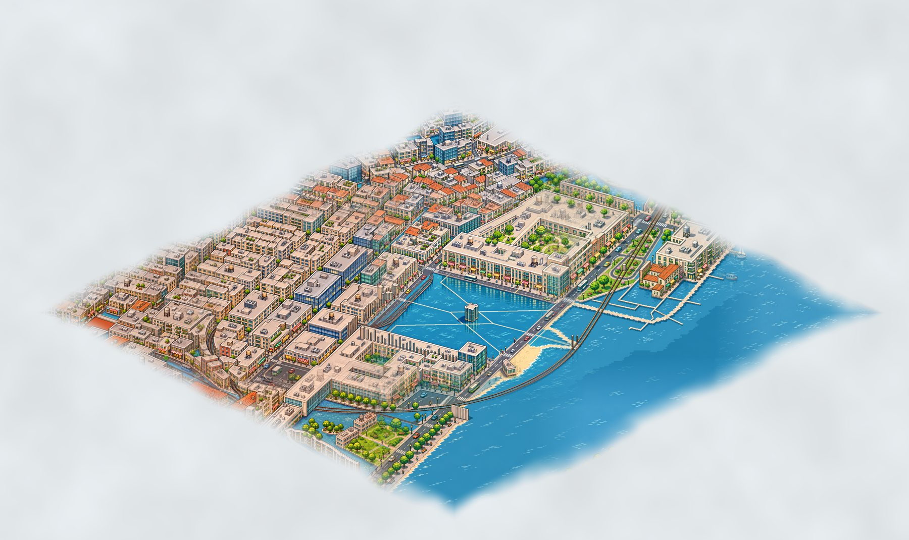

# Tiny

Make a Tiny of any place: a pixel-art isometric diorama of your street, neighbourhood or campus.

Tiny draws the place from OpenStreetMap and paints every tile with the image generation in your ChatGPT plan, inside Codex. No API key, no cost beyond your plan. The Tiny stays on your computer.


## Install

```
codex plugin marketplace add pqgventures/tiny
codex plugin add tiny@tiny
```

Then, in Codex:

```
@Tiny make a Tiny of Largo da Batata, São Paulo
```

## What happens

1. Tiny finds the place and draws a grey 3D base of its streets, buildings, parks, water and trees from OpenStreetMap, plus a 100 m margin where the city keeps going and fades into fog.
2. It paints each tile with the built-in image generation, from the centre outwards, keeping every street and building where it really is.
3. It stitches the tiles into one map (`~/Tiny/<place>/tiny.png`) and a viewer you can pan and zoom (`index.html`).

A default Tiny covers about 520 m across: 11 tiles, about 15 minutes. Ask for "a street corner" for a smaller one or "something bigger" for up to 800 m. Coasts and rivers come out as water.



Needs `python3` with Pillow and numpy (Codex installs them if missing) and a ChatGPT plan with image generation in Codex.

## License

Code: MIT (see LICENSE). Map data © [OpenStreetMap contributors](https://www.openstreetmap.org/copyright), available under the Open Database License (ODbL). A Tiny made from it is a produced work of OpenStreetMap data: when you share it, credit "© OpenStreetMap contributors".
